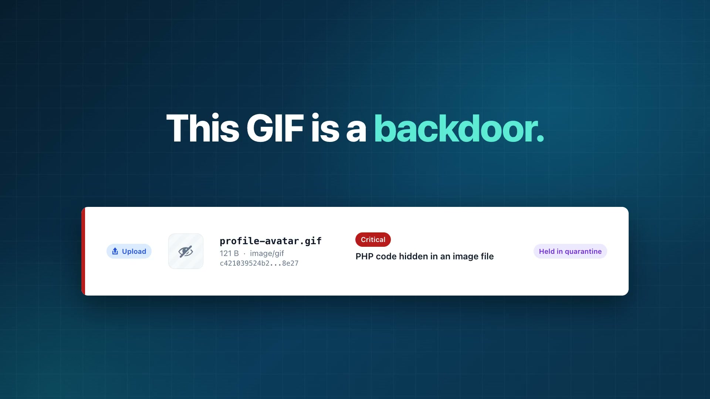

# Qartvelo Guard

**Nothing new runs on your WordPress site until you approve it.**

Qartvelo Guard scans the whole site for malware and backdoors, holds every new upload, plugin or theme install and unknown file until an administrator approves it, and remembers each approval by its SHA-256 fingerprint: allowed once, allowed always.

- Website and documentation: https://qartvelo.com/qartvelo-guard
- Previously named CyberGate Security (renamed in 1.1.0).
- Download: [latest release](https://github.com/kakha13/qartvelo-guard/releases/latest) (WordPress.org listing pending review)

[](media/qartvelo-guard-promo.mp4)

**Watch the 22-second video:** [landscape](media/qartvelo-guard-promo.mp4) or [vertical for Reels, Shorts and TikTok](media/qartvelo-guard-promo-vertical.mp4).

## Features

- **Whole-site scan.** Core, plugins, themes, uploads and the web root, with core and WordPress.org plugin files checked against their official checksums.
- **Upload and install holding.** Media uploads, sideloads, plugin and theme ZIPs and new installs wait in a private quarantine until you decide. Busy sites can hold only risky uploads.
- **Allow once, allowed always.** Approvals are remembered by SHA-256 fingerprint and bound to executability: a file approved as an image is never accepted as PHP.
- **What changed.** A line by line diff against the last approved copy or the official original, with secrets masked.
- **Early upload guard.** An optional `auto_prepend_file` guard that holds uploads sent to any PHP script, installed with one click and a live test, with rollback.
- **Clean core reinstall.** Replace damaged WordPress core with an official copy verified file by file, with automatic rollback and a restorable backup.
- **Database scan and administrator watch.** Injected scripts in options and posts, and new administrator accounts.
- **Hosting aware.** Detects cPanel, CyberPanel, Plesk, aaPanel, DirectAdmin and many more, and shows that panel's own steps first.
- **Optional antivirus engines.** ClamAV and Linux Malware Detect with a real self-test. They find more known infections; they do not block attacks.
- **Multisite, WP-CLI and a downloadable security report.**
- **Fast.** No database queries on visitor pages, none on a normal admin page.

## Requirements

WordPress 6.0 or newer, PHP 7.4 or newer. Apache, nginx, LiteSpeed/OpenLiteSpeed and IIS are supported.

## Install

1. Download `qartvelo-guard.zip` from the [latest release](https://github.com/kakha13/qartvelo-guard/releases/latest).
2. In WordPress open **Plugins > Add New Plugin > Upload Plugin**, choose the ZIP, install and activate.
3. The setup wizard opens. Follow it: it takes a few minutes.

Every release lists its SHA-256 checksum. Older versions stay available on the [releases page](https://github.com/kakha13/qartvelo-guard/releases).

## Repository layout

| Path | What it is |
|---|---|
| `qartvelo-guard/` | The plugin |
| `docs/ARCHITECTURE.md` | Module contracts, read before changing cross-module APIs |
| `scripts/build.sh` | Lint, package and verify the release ZIP (`--wporg` adds WordPress.org checks) |
| `server-tools/cgav.sh` | Server helper for ClamAV and Linux Malware Detect (run by an administrator, never by the plugin) |
| `wporg-assets/` | WordPress.org icon, banner and screenshots |
| `media/` | The launch video (landscape and vertical) and its poster |

## Development

```bash
scripts/build.sh
```

The build checks PHP syntax, JavaScript syntax and the version numbers, stages the plugin without development files, rebuilds `checksums.json` and writes `dist/qartvelo-guard-<version>.zip` with a `.sha256` file.

After changing any plugin file, rebuild the checksums so the plugin does not report its own files as modified:

```bash
php qartvelo-guard/bin/build-checksums.php
```

Code rules: PHP 7.4 compatible syntax, WordPress 6.0+, capability checks and nonces on every handler, no em or en dashes. See `CLAUDE.md` and `docs/ARCHITECTURE.md`.

## Releasing

1. Raise the version in `qartvelo-guard/qartvelo-guard.php` (header and `WPCYBERSEC_VERSION`) and the readme `Stable tag`, and add a changelog entry.
2. Commit, then tag and push: `git tag v1.0.1 && git push origin v1.0.1`.
3. The release workflow builds the ZIP, checks the tag matches the plugin version and publishes a GitHub release with `qartvelo-guard-<version>.zip`, `qartvelo-guard.zip` and the checksum.

## Security

Please report vulnerabilities privately, see [SECURITY.md](SECURITY.md).

## License

GPL-2.0-or-later. See [LICENSE](LICENSE).
